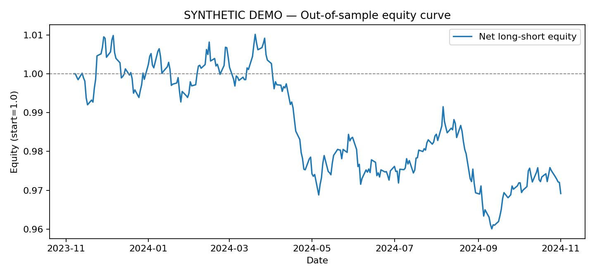
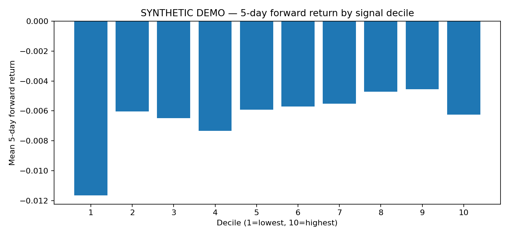

# Cross-Sectional Alpha Research & Market-Neutral Equity Strategy

> **Synthetic-data research demonstration.** All securities (`SYN001`, …), prices, volumes, sector assignments and fundamental ratios are simulated. This project does **not** establish any live-trading performance or historical investment returns. Do not present the metrics as a real equity backtest.

A reproducible Python research prototype of the workflow: **synthetic daily close/volume panel → 50 factors → walk-forward factor selection → cross-sectional rank IC/decile/decay research → sector- and beta-neutral long-short weights → cost-aware illustrative backtest**.

## Quick start

```bash
python -m pip install -r requirements.txt
python run_pipeline.py
python -m unittest discover -s tests -v
```

The included `data/synthetic_equities.csv` was generated deterministically using `--seed 42`. To regenerate it:

```bash
python run_pipeline.py --generate --seed 42 --n-assets 80 --n-days 740
```

The demo is fully offline; no market data APIs or accounts are needed. You can point `--data` to your own CSV with columns `date,ticker,sector,close,volume` (and optional `earnings_yield,book_to_price,sales_to_price`). **User-supplied prices have not been validated** for corporate actions, ticker changes, historical index membership, delistings or point-in-time fundamentals.

## Research coverage

| Research stage | What the code implements |
| --- | --- |
| Data | 80 fictional equities, 10 fictional sector labels, 740 business days, synthetic quarterly fundamentals |
| Factors | 50 features: multiple lookbacks for momentum, skipped momentum, reversal, realized/downside volatility, skew, volume anomaly, dollar volume, Amihud illiquidity proxy, moving-average distance, drawdown, rolling beta, market-residual and sector-relative momentum, autocorrelation, and 3 synthetic fundamental ratios |
| Diagnostics | Daily Spearman rank IC for each feature, IC over 1/5/10/21-day horizons, decile forward returns and top-minus-bottom spreads |
| Model selection | Rolling 378-session **past** rank IC, refresh every 21 sessions, 6-session embargo on future-return labels, choose one top candidate per factor family |
| Neutralization | Initial top-/bottom-decile long-short portfolio projected onto the nullspace of sector indicator exposures and rolling estimated market beta, normalized to 100% gross |
| Trading | Rebalance every 5 sessions; two-session signal-to-return lag; commission + half-spread + square-root participation impact proxy + short-borrow financing |
| Testing | Automated causal-feature, 50-factor count, dollar-/sector-/beta-neutrality and nonnegative-cost assertions |

**Note:** Market beta is estimated versus the equal-weighted universe return, *not* a named market index. Beta and sector neutrality are enforced at each **rebalance decision date**, not continuously between rebalances. Nullspace projection may create small positions outside the original deciles. The close-based two-session lag is a conservative simplification; it is not a broker-grade execution simulator.

## Repository layout

```text
cross_sectional_alpha_research/
├── data/synthetic_equities.csv        # Clearly fictional sample observations
├── src/data.py                         # Deterministic offline synthetic generator
├── src/factors.py                      # 50 strictly backward-looking features
├── src/research.py                     # IC, factor selection, walk-forward & deciles
├── src/portfolio.py                    # Neutral weights, costs & OOS backtest
├── tests/test_research.py              # Automated tests
├── reports/                            # Generated charts, metrics and CSV reports
├── run_pipeline.py                     # One-command analysis entry point
├── requirements.txt
└── .github/workflows/tests.yml         # GitHub Actions test runner
```

## Example outputs

All plots and metrics are marked as a **synthetic demonstration**.

- `reports/equity_curve.png`: OOS net equity; `reports/equity_curve.csv`: gross return, trading cost, borrow cost, net return, drawdown.
- `reports/decile_returns.png`, `reports/decile_summary.csv`, `reports/daily_decile_returns.csv`: diagnostic forward returns (overlapping 5d horizons; **not** tradable realized decile P&L).
- `reports/factor_ic.png`, `reports/factor_ic_oos.csv`, `reports/factor_decay_oos.csv`: Spearman factor diagnostics and signal decay.
- `reports/neutrality_checks.csv`: dollar, sector and estimated-beta exposures at each decision date.
- `reports/walk_forward_selection.csv`: selected features, training IC and the latest eligible training-label date per refit.
- `reports/rebalance_targets.csv`, `reports/positions.csv`: tradeable targets (after lag) vs decision-date holdings.
- `reports/metrics.json`: configuration, cost parameters and synthetic backtest metrics.

### Example charts





## Methodology and limitations

1. **Avoid look-ahead:** Factors only use current and historical closing data. The next-day / 5-day / 10-day / 21-day returns are *labels*, not inputs to the score. Model selection uses labels whose endpoints predate a selection date; the 6-session exclusion is conservative.
2. **Out-of-sample:** First 65% of dates are used for warmup, followed by walk-forward refits on rolling past history. No hindsight hyperparameter tuning is performed, and reported performance may be negative.
3. **Market-neutral:** Neutrality means **estimated** sector-sum and beta exposure at selection, not immunity to market risk. To keep this a small transparent example, the code does not model optimization constraints for individual position caps, tradability, real borrow availability, tax, funding spreads or survivorship bias.
4. **Transaction cost model is a proxy:** Commission 1 bps/side, half-spread 3 bps/side, estimated square-root participation price impact with assumed capital $5m, and 2% annual short-borrow cost. There are no actual executions, NBBO quotes, volumes-at-price or exchange calendars. Change parameters in `src/portfolio.py` to conduct sensitivity analysis.
5. **Synthetic fundamentals:** `earnings_yield`, `book_to_price`, and `sales_to_price` are generated once per simulated quarter and then held constant. They are not verified financial disclosures or timestamped filing surprises.
6. **Missing real-world controls:** Corporate actions, survivorship-free universes, delisted assets, ticker mappings, industry classification history, actual borrow constraints, market-calendar gaps and capacity need research before interpreting real results.


## License

MIT — see `LICENSE`.

## Upload to GitHub

1. Create a public repository called `cross-sectional-alpha-research`.
2. Upload the **contents** of this extracted folder (including `src/`, `data/`, `reports/`, `tests/` and `.github/`).
3. Keep the `SYNTHETIC DEMONSTRATION` disclosure and avoid renaming the synthetic ticker labels.
4. Verify the GitHub Actions workflow passes. The README charts are linked via relative file paths and should render automatically.
